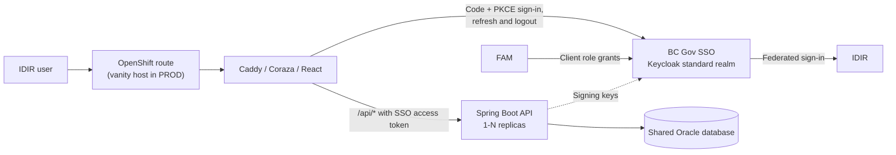

# ISP architecture

ISP is a React single-page application backed by a Spring Boot API, running as separate workloads
on OpenShift and keeping the shared Oracle database as its system of record. The layout, delivery
pipeline and security model follow [nr-lexis](https://github.com/bcgov/nr-lexis).

## Runtime overview

The frontend and backend are separate container images. Caddy serves the static application,
applies Coraza WAF rules and security headers, and proxies `/api*` to the backend Service. The
backend has no public Route: its NetworkPolicy admits only the frontend pods and the monitoring
namespace.

| Component | Responsibility |
|---|---|
| React frontend | Interactive pages, sign-in, navigation. Shows what the session allows; never the security boundary. |
| Spring Boot backend | REST endpoints under `/api`, token validation, role checks, Oracle access, reports. |
| Oracle | System of record for ISP data, reference codes and audit columns. |
| BC Gov SSO and FAM | Sign-in through the Keycloak standard realm; FAM grants the ISP client roles. |

## Identity and authorization

Users sign in with IDIR through BC Gov SSO. The browser uses the public ISP client with
authorization code and PKCE, keeps tokens in `sessionStorage`, and refreshes them on demand,
sharing one refresh between concurrent callers.

The backend accepts a token only when all of these hold:

- RS256 signature from the configured realm's signing keys, issuer and expiry are valid;
- `azp` is the ISP client ID and `typ` is `Bearer` (an access token, not an ID or refresh token);
- `identity_provider` is `idir` or `azureidir`.

FAM client roles arrive in `client_roles` (or Keycloak's `resource_access.<client>.roles`). Only
`ISP_ADMIN` and `ISP_APPROVER` grant anything; they become Spring authorities with the same names.
`GET /api/session/me` returns the user's IDIR username, name, email and roles so the frontend can
show the right pages.

| Request | Who |
|---|---|
| `GET /api/status`, `/actuator/health/**`, `/actuator/info`, `/actuator/prometheus` | Anyone |
| `GET /api/session/**` | Any signed-in IDIR user, including users without an ISP role |
| `/api/internal/**` | Administrator |
| Other `GET /api/**` | Administrator, Approver |
| `POST /api/R10`–`R13`, `PATCH /api/sales-summary/approval`, `PATCH /api/sales-summary/mill-report-approval` | Administrator, Approver |
| Other `POST`, `PUT`, `PATCH`, `DELETE` on `/api/**` | Administrator |
| Anything else | Nobody |

These rules carry forward the CGI rebuild's `SecurityConfig`, with one correction: its
`/internal/**` admin rule never matched the `/api/internal/...` paths its controllers used, so a
future internal `GET` would have been open to Approvers. Here the rule matches `/api/internal/**`.

The API is stateless: no HTTP session, no cookies, and therefore no CSRF token. CORS is closed by
default because the SPA calls the API through the same-origin Caddy proxy.

## Data

Oracle remains the system of record. The `oracle` Spring profile enables a Hikari pool over TCPS;
an init container builds the truststore for `DATABASE_HOST` on every pod. Repositories use
`NamedParameterJdbcTemplate` with hand-written SQL, as the CGI rebuild does; there is no JPA. Audit
columns (`entry_userid`, `update_userid`) take the IDIR username from the token
(`IspUser.requiredUsername()`); a write from a token without one is refused with a 401.

Oracle `DATE` columns hold B.C. wall-clock time. The API returns timestamps with the JVM's offset
(`TZ=America/Vancouver`), for example `2024-03-04T10:00:00-08:00`; the CGI rebuild labelled the
same wall-clock values UTC.

## Porting pattern

Mill names (`/mills`) is the first ported page and the pattern for the rest.

| Layer | Pattern |
|---|---|
| Controller | `@RestController` mapped without `/api`, keeping the CGI rebuild's paths. It takes an `ObjectProvider` for each service and calls `OracleServices.require`, so without the `oracle` profile the API still starts and the endpoint answers 503. |
| DTOs | Hand-written records in `dto`, with Jakarta validation matching the CGI rebuild's OpenAPI schemas and the column lengths. JSON field names and date formats are unchanged. |
| Service | `@Service @Profile("oracle")` holding the business rules, `@Transactional`. Rejected input throws `ValidationConstraintViolationException`. |
| Repository | `@Repository @Profile("oracle")`, `NamedParameterJdbcTemplate`, SQL and row mapping in one class that returns the DTO records; no entities or mappers. |
| Errors | `ApiExceptionHandler` returns validation failures, business rules and database constraint violations as a 400 with a plain-text message, which the page shows as-is (as the CGI rebuild's `GlobalExceptionHandler` did). Anything else keeps Spring Boot's JSON error body. |
| Tests | Repositories run their SQL against H2 in Oracle mode (`db/isp-schema.sql`); services use Mockito; controllers use MockMvc with a mocked service; `MillsEndToEndTest` runs the `oracle` wiring against H2. `SecurityConfigurationTest` owns the role rules. |
| Frontend | A page under `src/pages`, an API client in `src/service` built on `apiFetch`, and the CGI rebuild's shared components under `src/components/common`. |

The CGI rebuild generated Spring interfaces and DTOs from an OpenAPI spec. They are not carried
over: hand-written records are shorter than the generated models, need no build-time generation
step, and match nr-lexis. The CGI rebuild's spec (`backend/src/main/resources/openapi`) remains the
reference for each endpoint's contract when porting; publishing a spec from the code (springdoc)
can follow if a consumer needs one.

The frontend uses plain Carbon rather than the CGI rebuild's `@bcgov-nr/nr-theme`, as nr-lexis
does. That package only supplied design tokens and component colour overrides; ported styles use
Carbon tokens (`var(--cds-...)`) instead of fixed colours, so the white and g100 themes both work
without per-theme rules.

## Deployment and operations

GitHub Actions builds and scans both images and deploys them to the Gold cluster with OpenShift
templates (`backend/openshift.deploy.yml`, `frontend/openshift.deploy.yml` and the two frontend
Route templates).

- Pull requests deploy an isolated DEV preview. Its hostname uses a slot (`PR % 50`) so a fixed set
  of SSO redirect URIs covers every preview.
- A merge to `main` deploys the merged PR's images to TEST, pinned by digest, runs the smoke suite
  and records a release candidate.
- **Release PROD** deploys the exact tested digests for a tagged commit. It never rebuilds images.
- PROD uses `https://isp.nrs.gov.bc.ca` (`VANITY_HOST`) through the edge Route in
  `frontend/openshift.vanity-route.yml`; DEV and TEST use the generated Gold Route.

Deployment settings live only in the GitHub Environments, because GitHub otherwise falls back
silently to a repository- or organization-level value of the same name. A job with no environment
fails the deployment if any database, namespace, SSO, origin or PROD hostname setting exists at
those levels. Before backend rollout, the environment's own values must be present, its
`oc_namespace` must end in `-<environment>`, and its SSO issuer must be that environment's
`loginproxy` realm. Missing PROD hostname or TLS inputs also fail before backend rollout. After applying a Route, the workflow verifies
the expected hostname and frontend Service target and waits for router admission. This does not
establish public DNS, certificate validity or a successful SSO round trip. The [deployment setup
instructions](../README.md#deployments) list the required Environment settings
and release recovery steps.

Backend replicas scale on CPU with an HPA, roll one pod at a time, and drain gracefully before
shutdown. Readiness does not depend on the Oracle pool, so a slow database cannot take every replica
out of the Service at once; startup still fails fast without Oracle.

## Changes from the CGI rebuild

| Concern | CGI rebuild (`bcgov-c/nr-isp`) | This repository |
|---|---|---|
| Delivery | One WAR with the SPA inside, on Tomcat 10 at `/pub/isp` | Separate Caddy and Spring Boot images on OpenShift, served at `/` |
| Framework | Spring Framework 7 wired by hand (no Boot) | Spring Boot 3.5 on Undertow |
| Sign-in | AWS Amplify with FAM's Cognito user pool, ID token | BC Gov SSO (Keycloak) with FAM roles, access token, `oidc-client-ts` |
| Roles | `cognito:groups` starting with `ISP_ADMIN` / `ISP_APPROVER` | FAM client roles matching `ISP_ADMIN` / `ISP_APPROVER` exactly |
| Database connection | Tomcat JNDI datasources from Ansible templates | Hikari pool configured from OpenShift Secrets |
| Configuration | Ansible templates and Vault | OpenShift template parameters from GitHub Environments |
| Pipeline | Polaris workflows, Jenkins and Ansible | GitHub Actions and OpenShift templates |
| Local auth | Mock login with fake roles | Real SSO; no mock users in the backend |
| API models | Generated from OpenAPI, plus Lombok entities and MapStruct mappers | Hand-written records |
| PDF exports | iText 7 (AGPL) | OpenPDF (LGPL/MPL) |
| Theme | `@bcgov-nr/nr-theme` tokens and overrides | Carbon tokens |

## Porting status

Done:

- Spring Boot backend scaffold: `/api` prefix for every REST controller, so ported controllers keep
  their mappings; Oracle profile; SSO token validation; access rules; health and metrics.
- React frontend scaffold: IDIR sign-in, session loading, no-access and error pages, layout and the
  CGI rebuild's navigation, with each page a placeholder until ported.
- Images, OpenShift templates, PR preview, TEST and PROD workflows.
- Mill names (`/mills`): list, filter, add, edit, delete and CSV/PDF export, with
  `GET /api/isp-sell-price-zone-codes` for its zone choices. Ported with it: `ReusableDataTable`,
  `MultiSelectWithTags`, `Dropdown`, `PageNotifications`, the toast region and their hooks and
  helpers. Changes from the CGI rebuild: CSV exports quote every text field (a comma in a mill
  name or comment no longer shifts the columns), exports send `Content-Disposition: attachment`
  rather than `form-data`, a failed initial load shows an error instead of an empty page, and new
  effective dates use the browser's local date rather than UTC.

Still to do:

- Port the business pages, controllers, services and repositories: inbox, search, sales summary,
  the other maintenance tables, the range checks and the R10–R13 reports. `GET
  /api/mill-report-status-codes` and `GET /api/mill-report-flag` were in the CGI rebuild's
  `MillsApiController` but serve the inbox and sales summary, so they move with those pages.
- Reports: R13 renders in-process from JRXML in the CGI rebuild; R10–R12 call the JCRS Jasper
  server. Embedded JasperReports for all four is in scope; add it with the first ported report.
- Mill submission ingestion from Oracle AQ (`MOF_QUEUES.ISP_Q`) and status messages to
  `MOF_QUEUES.ESF_STATUS_Q` ("ESF lift and shift"). This needs a second, raw Oracle connection and
  a decision on how one replica consumes the queue.
- Reference-data caching (Caffeine in the CGI rebuild), starting with the sell price zone codes.
- Optimistic locking: the CGI rebuild's saves ignore `REVISION_COUNT`, so the last of two
  concurrent edits wins. The mill names port keeps that behaviour.
- Session idle timeout, as nr-lexis has.
- FAM and CSS setup: the ISP client in each SSO environment, the two roles in FAM, and redirect
  URIs for the preview slots, TEST and the PROD vanity host.
- OpenShift namespace and the GitHub Environment settings listed in the [README](../README.md).
- Functional parity review against the original ISP application.
